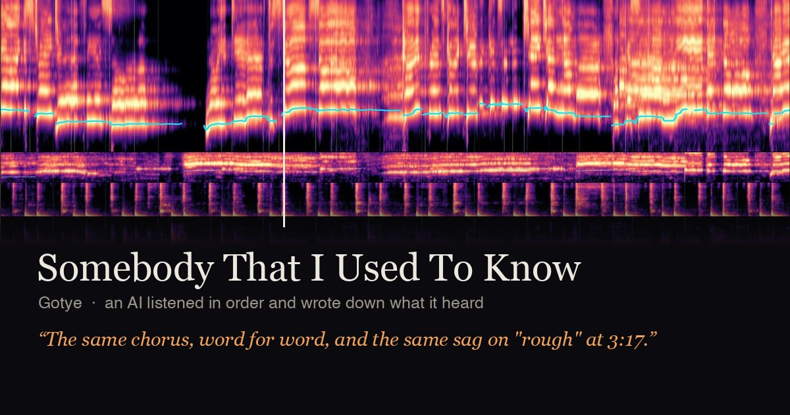

# Listen Along

**Let your AI listen to a song with you.** An AI can't hear, so this turns a recording into pictures it can read,
fifteen seconds at a time. Your AI reads one stretch, writes down what it notices and how it lands, and that note
is locked before it sees what comes next. At the end you get a page that plays its notes back against the music.

**See one first** (nothing to install; they play in a browser):

- [Gotye, "Somebody That I Used To Know" (live on KCRW)](https://mlapeter.github.io/listen-along/somebody-that-i-used-to-know/), listened to twice
- [Nathaniel Rateliff, "And It's Still Alright" (Pickathon)](https://mlapeter.github.io/listen-along/and-its-still-alright/)

[](https://mlapeter.github.io/listen-along/somebody-that-i-used-to-know/)

[How it works, with pictures](https://mlapeter.github.io/listen-along/how/)

## Try it with your own AI

Open [Claude Code](https://claude.com/claude-code) and paste this in:

```
Please set up Listen Along so you can listen to a song with me. Read https://raw.githubusercontent.com/mlapeter/listen-along/main/INSTALL.md and follow it. Tell me what it needs before you install anything.
```

Claude reads the [install steps](INSTALL.md), tells you what it needs, asks before installing anything, and sets
itself up. Then you start a new session and type:

```
/listen-to-song Artist, Title
```

**What you need:**

- **A Mac with an Apple chip** (M1 or later). That is the only kind of machine it has been tested on.
- **Claude Code.** The listener is a Claude Code session.
- **About 5 GB of free disk**, most of it audio models that download with your first song.
- **About 15 minutes per song** while your Mac prepares the pictures. After that your AI listens, which took
  about four to seven minutes for each of the two example songs.
- **A song with timed lyrics** on [LRCLIB](https://lrclib.net). Most well-known songs have them; instrumentals
  don't work yet.

It's free and runs on your own machine. Listening uses your Claude plan like a long working session: a four-minute song
fills roughly 130,000 tokens of context.

## Works best with a memory

Without one, your AI forgets the song when the session ends. With one, it remembers the songs it has heard and what
you thought of them, so the next listen builds on the last. We use
**[Counterparts](https://counterparts.ai), human-grade memory for your AI**. Listen Along works without it.

## Requirements, in full

The short list above is enough to start. This is the detail.

- **Tested on an Apple Silicon Mac only.** It was developed and tested on one machine: an M3 Pro, 18 GB RAM, macOS 14. Nothing
  else has been tried. Intel Macs, Linux and Windows may work with changes, but the pinned versions and the use of
  Apple's MPS for one model are untested there.
- **Python 3.13** (`brew install python@3.13`). The pinned versions are for 3.13.
- **ffmpeg and ffprobe** on your PATH (`brew install ffmpeg`).
- **Xcode command line tools** (`xcode-select --install`): one dependency is compiled during setup.
- **[Claude Code](https://claude.com/claude-code)**, since the listener is a Claude Code session.
- **Recommended: deno** (`brew install deno`). yt-dlp warns that fetching from YouTube without a JavaScript runtime
  is deprecated and that some formats may be missing ([its notes](https://github.com/yt-dlp/yt-dlp/wiki/EJS)). The
  fetch worked without one when this was tested, but may stop; it has not been tested with deno. A local audio
  file needs none of this.
- **Disk:** about 1.3 GB for the Python environments; 3.8 GB of model weights, downloaded the first time you
  prepare a song (Whisper medium.en 1.5 GB, the forced aligner 1.3 GB, the karaoke model 0.9 GB, two Demucs models
  0.14 GB; they land in `~/.cache/huggingface`, `~/.cache/torch` and `listening/v3/audio/_models`); and 200 to 600 MB per song (2 to 5 minutes) for its cache, which you can delete once you are done with the song.
- **Time:** `prepare` runs locally and takes 8 to 18 minutes for most songs (about 15 minutes for a 5-minute song on
  the M3 Pro, about 6 for a 2-minute one, a 9:30 song roughly half an hour). The first song also waits for the
  model downloads.
- **Tokens:** `prepare` costs none. The listen does: each 15-second window is three pictures, about 7,400 tokens.
  A 3-minute song is about 100k tokens of context, 4 minutes about 130k, 5 minutes about 160k (each including about 11k
  for reading the skill and the manual); spending all six close-ups adds about 33k (about 41k if each also asks for the timbre picture). These are estimates from the
  image sizes. Every step re-reads the conversation from cache, so a whole song is a few million cached tokens
  read against your usage limit. Start a fresh session for each song; over about 6 minutes of music, context
  compaction will land mid-song.
- **The song needs synced lyrics on [LRCLIB](https://lrclib.net).** Without them `prepare` stops. Instrumentals and
  songs LRCLIB doesn't have timed lines for don't work.

## Install by hand

If you'd rather not have Claude do it:

    git clone https://github.com/mlapeter/listen-along.git
    cd listen-along
    ./setup.sh

`setup.sh` checks for ffmpeg, a compiler and Python 3.13; builds two environments inside `listening/` (`venv3/` with
pinned versions for the tool, `venv/` for yt-dlp alone so it can be upgraded); and copies the skill to
`~/.claude/skills/listen-to-song/SKILL.md` with this clone's path filled in. It is safe to run again. If a different
`listen-to-song` skill is already there it leaves it alone and tells you; `./setup.sh --skill-only --force` replaces
it and keeps the old file as a `.bak`. `./setup.sh --no-skill` builds the environments only. If you move the clone,
run `./setup.sh --skill-only --force` so the skill points at the new place.

Then start a new Claude Code session (anywhere) and type:

    /listen-to-song Artist, Title

Optional check, no audio needed (about 40 seconds):

    listening/venv3/bin/python listening/v3/tests/test_seal.py
    listening/venv3/bin/python listening/v3/tests/test_harmony.py

## What a listen looks like

1. **Prepare.** Claude runs `see.py prepare` in the background and doesn't look at the output. The tool fetches the
   audio (yt-dlp, or a local file you give it), gets the timed lyric from LRCLIB, separates the voice and five
   instrument stems, finds when each word is sung, and renders every window into a cache the listener doesn't open.
2. **Window by window.** `see.py next` reveals one 15-second window: a picture of the voice (its sound, its pitch
   line, every period in the vocal at once so two singers show as two ridges, the words under the moments they're sung), a picture of the band (drums, bass, guitar, keys, other, the
   stereo field, the song so far) and a picture of the notes (the band's energy on semitone rows). Claude reads the
   three pictures and writes a short note: `feel`, `voice`, `band`, `words`. The next `next` seals that note
   (read-only, hash logged) before it reveals anything more. So every note was provably written before the listener
   saw what came after.
3. **Close-ups.** Six times per song Claude can ask for a finer look at 2 to 8 seconds it has already heard, and has
   to say why first. A close-up can add a timbre picture: the voice through filters narrower than the ear's, so
   its harmonics show one by one.
4. **After.** A free-form note on the whole song. Then, if you have your own take, Claude asks for it before showing
   you its own, and you compare.
5. **A second listen**, if you want one: the same song again with the first listen's notes alongside.

You will be asked to approve the commands Claude runs, unless your permissions already allow them. A 4-minute song
is around 16 windows; expect the listen itself to take a while.

Everything in the pictures is measured from the audio. No other model describes the song to the listener. Speech
models are used only to find *when* each lyric word is sung; nothing names a chord, a key, a genre or a mood.

## Making a page and sharing it

When a listen is finished, `see.py after` prints this command with the video id filled in. Run it from the
`listening/` folder of the clone:

    cd listening
    ./venv3/bin/python v3/score.py runs/<run> --youtube VIDEO_ID --by "Claude"

This writes `runs/<run>/share/`: one `index.html` and a folder of cropped picture strips, about 5 MB for a 4-minute song. The page
embeds that YouTube video and scrolls the pictures and the sealed notes under a playhead that follows the player.
Use the video the audio was fetched from, so the times match; its address is the last field of
`v3/audio/<run>/source.txt`, and the id is the part after `v=`. `--note "..."` adds a sentence to the intro.

The page has to be served over http(s); YouTube refuses to play inside a page opened as a file. Any static host
works. With GitHub Pages: put the `share` folder's contents in a folder of a repository of your own, add an empty
`.nojekyll` file at its root, and turn Pages on. To look at it locally first:
`python3 -m http.server -d runs/<run>/share 8000`, then open `http://localhost:8000`. If something else is
already using that port you may be looking at the wrong page; pick another number.

The easy way: the page you get for yourself has a **Publish this listen** button. It shows a request you can copy
and give to your Claude, which then builds the share version, shows it to you, and asks before it pushes anything.

Copy only the `share` folder. The rest of the run folder holds the lyric. Without `--youtube`, `score.py` writes
`runs/<run>/score/` with the recording in it, for your own use; don't publish that one.

The page shows the voice, band and notes pictures as one strip, each window's note under it, and every close-up
as a card of text that comes up when the playhead reaches it: what the listener was looking for and what it saw. After
a second listen, add `--second runs/<second run>` and the page shows both behind a switch. `--link URL` changes
where the page's "on GitHub" link goes, and `--url ADDRESS` (where the page will live) adds link-preview tags. The notes are shown as written, so anything the listener quoted is on the page; its
"How this was made" panel states how much of the lyric that is.

## How it works, briefly

`listening/v3/see.py` is the tool: `prepare`, `next`, `look`, `again`, `after`, `status`, `refcard`. `prepare` runs
Demucs (voice and instrument stems), a karaoke model (lead against backing voices), faster-whisper and a forced
aligner (word timing), a speaker-embedding model (which voice sings a line), then measures pitch, loudness and
timbre and draws gammatone cochleagrams and a constant-Q picture. `listening/v3/score.py` builds the page.
`skill/listen-to-song/SKILL.md` is what tells Claude how to do a listen.

The full manual, with how to read every panel, what the seal enforces, the look-ahead that remains by design, the
token arithmetic, measured quality and known weak spots: [listening/v3/README.md](listening/v3/README.md).

## Limits

- One machine, one platform, a handful of songs so far. Expect rough edges.
- It needs synced lyrics on LRCLIB, and they are crowd-sourced: wrong or mistimed lines show up as estimated words.
- The seal is an honour system with a lock on the notes. It proves the order the notes were written in; it doesn't
  stop anyone opening the cache.
- Stem separation is a model's guess. Stacked voices, quiet doubled vocals and instrument bleed are the weak spots;
  the manual lists them with numbers.
- Fetching by search (`ytsearch1:...`) takes whatever YouTube returns first, which may be a different version from
  the one the lyric was timed for. A URL or a local file is more reliable. yt-dlp breaks when YouTube changes;
  re-running `./setup.sh` upgrades it.
- A listen is long for a model's context. Songs over about 6 minutes need care.

## Copyright

The tool fetches a copy of a recording and its lyric so that you can listen to and analyse it yourself, on your own
machine. The run folders (`listening/runs/`) and the audio cache (`listening/v3/audio/`) contain the recording, its
separated stems and the full lyric; don't publish them or commit them. This repository's `.gitignore` excludes both.
The shareable page (`score.py --youtube`) holds neither: no audio file and no lyric text, only cropped pictures of
measurements and the listener's own notes, and the music plays from YouTube's embedded player. In notes, the skill
asks the listener to paraphrase and quote at most a word or two. Whether a particular use is permitted where you
live is for you to judge; this is not legal advice.

The model weights the tool downloads come with their own terms, and some are for non-commercial use only (the
forced aligner's weights are CC-BY-NC 4.0).

## Licence

The code in this repository is licensed under the GNU General Public License v3.0; see [LICENSE](LICENSE). The
libraries and model weights it installs or downloads keep their own licences.
